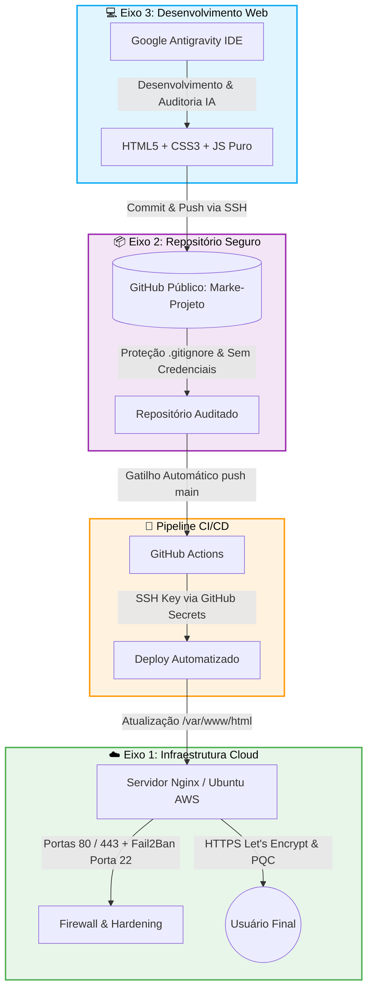

# Projeto Aplicado - Práticas de Mercado
## Relatório Técnico de Engenharia e Segurança

Este repositório contém os artefatos técnicos, o código-fonte e a documentação completa desenvolvida para a avaliação final da disciplina **Projeto Aplicado: Práticas de Mercado**. O projeto simula um ambiente de mercado real pautado nos princípios de *Secure by Design* e *Secure by Default*, integrando Infraestrutura em Nuvem, Controle de Versão Seguro, Desenvolvimento Web Seguro e Pipeline de CI/CD.

---

## 📌 Arquitetura Geral do Projeto

---

## ☁️ Eixo 1: Infraestrutura (Cloud Computing - Free Tier)

* **Provedor e Sistema Operacional:** Instância de nuvem na **AWS EC2 (Free Tier)** rodando **Ubuntu Server LTS**, configurada e operada diretamente pelo aluno.
* **Servidor Web:** **Nginx**, configurado para servir a aplicação web com alta performance e diretivas de segurança ativas.
* **Acesso Público e Resolução:** Acessível publicamente pelo endereço com IP elástico associado: `15.229.228.202.nip.io` (IP `15.229.228.202`).
* **Acesso Remoto Seguro:** Acesso administrativo exclusivamente via **chaves SSH (`id_ed25519`)**, com autenticação tradicional por senha (`PasswordAuthentication no`) desativada no `sshd_config`.
* **Firewall e Least Privilege:**
  * Exposição restrita às portas de serviço **80 (HTTP)** e **443 (HTTPS)** no Security Group da AWS.
  * A porta administrativa **22 (SSH)** está protegida ativamente pelo **Fail2Ban**, configurado com tolerância máxima de **4 tentativas incorretas** e penalidade de **banimento por 24 horas**.
* **Criptografia e Certificado (HTTPS):**
  * Certificado SSL/TLS emitido via **Certbot (Let's Encrypt)** com autorrenovação configurada via systemd timer/cron.
  * Redirecionamento automático e compulsório de todo o tráfego HTTP para HTTPS configurado no Nginx (`return 301 https://$host$request_uri;`).
  * Suporte criptográfico validado para **PQC (Post-Quantum Cryptography)** e conformidade nos validadores de TLS/SSL com notas máximas de segurança.

---

## 📦 Eixo 2: Repositório (Hospedagem e Versionamento)

* **Plataforma e Visibilidade:** Repositório público hospedado no GitHub sob a organização/usuário [`Marke-Projeto/projeto-aplicado`](https://github.com/Marke-Projeto/projeto-aplicado).
* **Autenticação Segura:** Todas as operações de *commit* e *push* são autenticadas por meio de chave assimétrica **SSH (Ed25519)** associada à conta do GitHub.
* **Prevenção de Vazamento de Dados:**
  * O arquivo [`.gitignore`](file:///home/fabianamadelinedasilvabezerra/projeto-aplicado/.gitignore) foi rigorosamente configurado para barrar o envio de arquivos de ambiente (`.env`), chaves privadas (`*.pem`, `*.key`, `id_rsa`, `id_ed25519`), certificados, caches e configurações locais de IDEs.
  * O código-fonte **não contém senhas ou chaves de API em texto claro**, em conformidade estrita com as diretrizes do edital.

---

## 💻 Eixo 3: Desenvolvimento Web e Mitigações OWASP Top 10:2025

A aplicação foi construída com foco em **Secure by Design** e **Secure by Default**, utilizando **HTML5, CSS3 e JavaScript puro**, desenvolvida e auditada na IDE **Google Antigravity**. A solução atende integralmente ao requisito de autenticação e proteção em modelo *front-end*:

* **Estrutura Mínima Entregue:**
  1. **Tela de Login (`index.html`):** Formulário protegido com validação de credenciais, rate limiting e mensagens neutras.
  2. **Página Interna Restrita (`dashboard.html`):** Área restrita protegida por verificação de integridade de sessão e exibição segura de dados.
  3. **Botão de Logout Funcional (`script.js`):** Revogação de sessão (`sessionStorage.removeItem`) e expurgo do histórico de navegação via `window.location.replace()`.

### Mitigações das 3 Vulnerabilidades da OWASP Top 10:2025

#### 1. A01:2025 - Broken Access Control (Quebra de Controle de Acesso)
* **Problema mitigado:** Tentativa de acesso direto e não autenticado ao painel restrito via manipulação direta de URL, histórico do navegador ou requisições paralelas.
* **Implementação no código:**
  * **Guarda no Cabeçalho (`<head>` em `dashboard.html`):** Script inline de execução imediata que verifica `sessionStorage.getItem("autenticado") !== "sim"`. Caso o usuário não possua sessão válida, é redirecionado instantaneamente para `index.html` antes de qualquer elemento do DOM ser processado ou renderizado.
  * **Ocultação Preventiva do Conteúdo:** O corpo da página é configurado com `display: none;` por padrão no CSS de `dashboard.html`, sendo alternado para `display: flex;` via JavaScript apenas após a validação bem-sucedida da sessão, prevenindo vazamentos visuais (*Flash of Unauthenticated Content*).
  * **Logout Seguro:** A função `logout()` em `script.js` revoga a chave de autenticação e utiliza `window.location.replace("index.html")`, substituindo o histórico da aba para impedir que o botão "Voltar" do navegador reabra o painel.

#### 2. A05:2025 - Injection (Injeção / Cross-Site Scripting - XSS)
* **Problema mitigado:** Injeção de códigos maliciosos através dos campos de formulário e manipulação insegura de nós dinâmicos do DOM.
* **Implementação no código:**
  * **Política de Segurança de Conteúdo (CSP):** Cabeçalho declarativo `<meta http-equiv="Content-Security-Policy">` restringindo a origem dos recursos para `default-src 'self'`, inibindo o carregamento de scripts externos maliciosos.
  * **Sanitização de Entidades HTML:** Função `sanitizar()` em `script.js` que isola entradas de texto em elementos em memória para neutralizar tags maliciosas (`<script>`, `onerror`, etc.).
  * **Manipulação Segura do DOM (`textContent`):** Todas as atualizações dinâmicas de interface — incluindo a exibição de mensagens de erro/bloqueio (`#mensagemErro`) e o nome do usuário autenticado no painel (`#usuarioConectado`) — utilizam estritamente a propriedade `textContent`, garantindo que o motor do navegador interprete os dados como texto plano inofensivo e nunca como HTML executável.

#### 3. A07:2025 - Identification and Authentication Failures (Falhas de Identificação e Autenticação)
* **Problema mitigado:** Ataques de força bruta automatizada (*brute force*), ataques de dicionário e enumeração de usuários (*User Enumeration*).
* **Implementação no código:**
  * **Hashing Criptográfico com Web Crypto API:** Nenhuma credencial em texto claro é armazenada no código-fonte. O sistema calcula em tempo real o digest criptográfico **SHA-256** utilizando a API nativa do navegador (`crypto.subtle.digest('SHA-256', ...)`) e compara com os hashes autorizados esperados.
  * **Rate Limiting Persistente no Cliente (`localStorage`):** Limite de **3 tentativas incorretas consecutivas**. Ao atingir o limite, o sistema impõe um bloqueio temporal de **30 segundos**, gravando o timestamp limite (`bloqueadoAte`) e o total de falhas no `localStorage`. Esse mecanismo impede que o usuário contorne o bloqueio recarregando a página (F5).
  * **Contador Regressivo e Feedback Neutro:** O botão de envio é desativado durante a penalidade e um temporizador regressivo em tempo real é exibido na tela. Mensagens de erro padronizadas (*"Credenciais inválidas"*) impedem a descoberta de se o erro ocorreu no usuário ou na senha.

---

## 🔄 Integração e Entrega Contínuas (CI/CD)

O ciclo de vida da aplicação é 100% automatizado através do **GitHub Actions** ([`.github/workflows/deploy.yml`](.github/workflows/deploy.yml)):

1. O desenvolvedor realiza alterações seguras na IDE **Google Antigravity**.
2. Ao executar `git push origin main`, o gatilho da pipeline é acionado automaticamente.
3. O workflow do GitHub Actions:
   * Inicializa um runner Linux temporário (`ubuntu-latest`).
   * Configura a chave privada SSH do servidor armazenada de forma segura em **GitHub Secrets (`${{ secrets.SSH_PRIVATE_KEY }}`)**, sem qualquer exposição no repositório.
   * Conecta-se ao servidor de produção AWS EC2 via SSH.
   * Sincroniza o repositório (`git fetch` / `git reset --hard origin/main`).
   * Publica os arquivos web no diretório do Nginx (`/var/www/html/`).
   * Reinicia o serviço Nginx (`sudo systemctl restart nginx`) de forma graciosa.

---

## ✅ Checklist Final de Entrega do Edital

* [x] A aplicação Web está no ar e acessível por um IP público na AWS EC2 (Eixo 1).
* [x] O Web Server (Nginx) está configurado com HTTPS (Certbot/Let's Encrypt) e redireciona HTTP para HTTPS automaticamente (Eixo 1).
* [x] Os testes de TLS/SSL e suporte a PQC (Post-Quantum Cryptography) foram configurados e validados (Eixo 1).
* [x] O acesso à nuvem utiliza chaves SSH (sem login por senha) e Fail2Ban ativo na porta 22 (4 tentativas / 24h ban) (Eixo 1).
* [x] O código está versionado em um repositório público no GitHub com autenticação segura (Eixo 2).
* [x] O `.gitignore` está configurado e nenhuma chave, senha ou credencial foi exposta (Eixo 2).
* [x] A aplicação possui Login, Página Interna Restrita e Logout funcional, desenvolvida com o auxílio da IA via IDE Google Antigravity (Eixo 3).
* [x] O `README.md` detalha exaustivamente as 3 categorias do OWASP Top 10:2025 mitigadas e sua localização no código (Eixo 3).
* [x] O fluxo de implantação está 100% automatizado com pipeline de CI/CD via GitHub Actions disparada a cada push (Integração e Entrega Contínuas).
